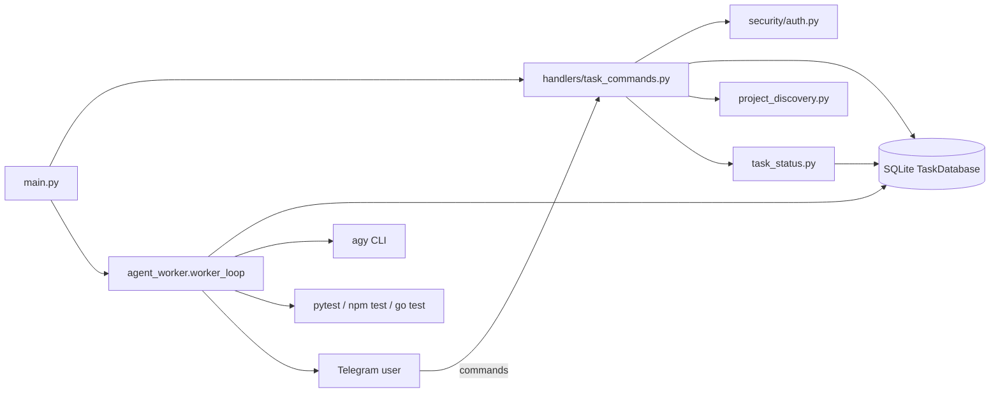
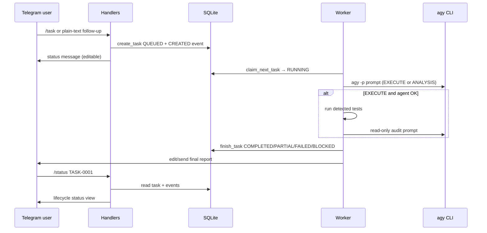
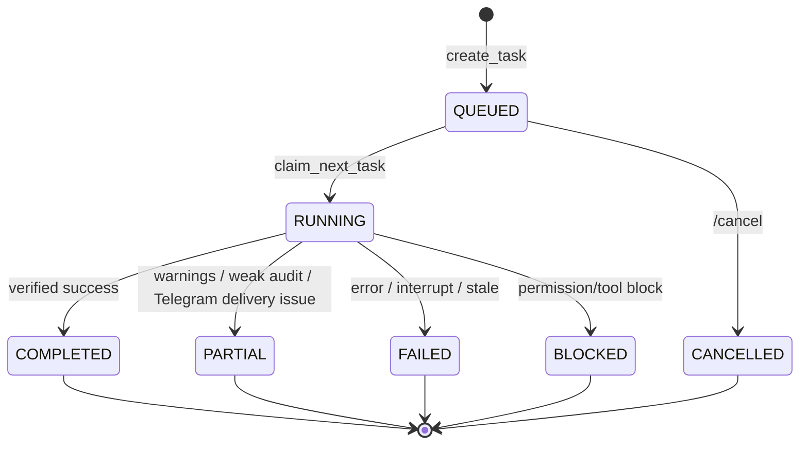

# DevTask Bot

Telegram bot that discovers local coding projects, queues development tasks in SQLite, and runs them through an Antigravity (`agy`) worker with progress updates, tests, and post-task audit reporting.

Bot Telegram tự phát hiện dự án code trên máy, xếp hàng task trong SQLite, rồi chạy qua worker Antigravity (`agy`) kèm cập nhật tiến độ, kiểm thử và báo cáo audit sau task.

---

## Table of contents / Mục lục

- [Overview / Tổng quan](#overview--tổng-quan)
- [Features / Tính năng](#features--tính-năng)
- [Architecture / Kiến trúc](#architecture--kiến-trúc)
- [Project structure / Cấu trúc dự án](#project-structure--cấu-trúc-dự-án)
- [Prerequisites / Yêu cầu trước khi cài đặt](#prerequisites--yêu-cầu-trước-khi-cài-đặt)
- [Installation / Hướng dẫn cài đặt](#installation--hướng-dẫn-cài-đặt)
- [Configuration / Cấu hình](#configuration--cấu-hình)
- [Telegram Bot usage / Hướng dẫn sử dụng Telegram Bot](#telegram-bot-usage--hướng-dẫn-sử-dụng-telegram-bot)
- [Task lifecycle / Vòng đời task](#task-lifecycle--vòng-đời-task)
- [Logging and troubleshooting / Log và xử lý sự cố](#logging-and-troubleshooting--log-và-xử-lý-sự-cố)
- [Testing / Kiểm thử](#testing--kiểm-thử)
- [Security / Bảo mật](#security--bảo-mật)
- [Limitations and roadmap / Giới hạn và định hướng](#limitations-and-roadmap--giới-hạn-và-định-hướng)
- [Contributing / Đóng góp](#contributing--đóng-góp)
- [License / Giấy phép](#license--giấy-phép)

---

## Overview / Tổng quan

**English**

DevTask Bot is a personal coding assistant delivered over Telegram. Authorized users select a project on their machine, describe work in plain language, and the bot:

1. Stores the task in a durable SQLite queue.
2. Runs an Antigravity CLI agent (`agy -p …`) inside the project directory.
3. Optionally runs a detected local test command (pytest / `npm test` / `go test`).
4. For execute-mode tasks, runs a read-only post-task audit pass.
5. Updates a live Telegram status message and persists reports, errors, and lifecycle events.

Intended users are solo developers or small teams who want Telegram-triggered agent work on a trusted Mac that already has their repositories and the `agy` CLI installed.

**Tiếng Việt**

DevTask Bot là trợ lý lập trình cá nhân qua Telegram. Người dùng được cấp quyền chọn dự án trên máy, mô tả công việc bằng ngôn ngữ tự nhiên, rồi bot sẽ:

1. Lưu task vào hàng đợi SQLite bền vững.
2. Chạy agent Antigravity (`agy -p …`) trong thư mục dự án.
3. Khi nhận diện được, chạy lệnh test cục bộ (pytest / `npm test` / `go test`).
4. Với chế độ triển khai, chạy thêm bước audit chỉ-đọc sau task.
5. Cập nhật tin nhắn trạng thái trên Telegram và lưu báo cáo, lỗi, sự kiện vòng đời.

Đối tượng phù hợp: lập trình viên cá nhân hoặc nhóm nhỏ muốn giao việc cho agent qua Telegram trên máy Mac đã có sẵn mã nguồn và CLI `agy`.

---

## Features / Tính năng

### Implemented / Đã triển khai

| Area / Hạng mục | English | Tiếng Việt |
|---|---|---|
| Auth | Allow-list by numeric Telegram user ID | Chỉ user ID trong allow-list được dùng bot |
| Discovery | Auto-scan common folders under `$HOME` (or `PROJECT_SCAN_ROOT`) | Tự quét thư mục phổ biến trong home (hoặc `PROJECT_SCAN_ROOT`) |
| Task modes | `/task` = EXECUTE + audit; `/readproject` = ANALYSIS read-only | `/task` triển khai + audit; `/readproject` chỉ đọc |
| Queue | SQLite `tasks` + `task_events` | Hàng đợi và lịch sử sự kiện trong SQLite |
| Worker | Background `worker_loop`, one task at a time | Worker nền, xử lý tuần tự từng task |
| Status | `/status 14` or `/status TASK-0014` lifecycle view | Xem lifecycle thật từ DB |
| Cancel | Cancel `QUEUED` tasks only | Chỉ hủy task đang `QUEUED` |
| Pause | `/off` pauses claiming new queued work; `/start` resumes | `/off` tạm dừng nhận task mới; `/start` bật lại |
| IDE open | `/open` uses platform helper (`open -a` on macOS; editor CLI / Explorer on Windows) | `/open` dùng helper đa nền tảng (macOS `open -a`; Windows CLI IDE / Explorer) |
| Tests (code) | `pytest` suite for status/lifecycle helpers | Có bộ pytest cho status/lifecycle |

### Partial / Incomplete / Một phần hoặc chưa hoàn chỉnh

| Item | English | Tiếng Việt |
|---|---|---|
| Menu `projectbuttons` | Listed in Telegram command menu, **no handler registered** | Có trong menu nhưng **chưa có handler** |
| `/clearhistory` | Registered, but calls an undefined `reply_text` helper → runtime error if used | Đã đăng ký nhưng gọi helper không tồn tại → lỗi khi dùng |
| Windows live run | Code + mocked tests only; no Windows host execution in this workspace | Chỉ code + test mock; chưa chạy host Windows tại đây |
| `config/project_colors.json` | Classifier supports it; file may be absent (safe fallback) | Classifier hỗ trợ; file có thể thiếu (fallback an toàn) |
| `config/projects.json` | Present but empty; discovery does not depend on it when auto-scan is on | File tồn tại nhưng rỗng; auto-scan không phụ thuộc file này |
| Legacy statuses | Older DB rows may still say `SUCCEEDED` / `COMPLETED_WITH_WARNINGS`; `/status` normalizes display | Bản ghi cũ có thể còn status legacy; `/status` chuẩn hóa khi hiển thị |
| Linux | Unverified | Chưa xác minh |

### Known limitations / Giới hạn đã biết

- Single-worker, single-task concurrency.
- Agent can modify project files; there is no separate sandbox VM.
- Test detection is heuristic and may skip unknown stacks.
- `/cancel` accepts numeric IDs only (`1`), not `TASK-0001`.
- No systemd/launchd unit is shipped; the bot runs in a foreground Terminal process unless you add your own service.
- Repository currently has **no license file** and, in this workspace copy, is **not initialized as a Git repository**.

---

## Architecture / Kiến trúc

**English**

Main components:

- `app/main.py` — entry point, Telegram application, command registration, starts `worker_loop`.
- `app/handlers/task_commands.py` — Telegram commands and conversation flows.
- `app/services/agent_worker.py` — claims queued tasks, runs `agy`, tests, audit, Telegram updates.
- `app/services/project_discovery.py` — filesystem project discovery by markers.
- `app/services/task_status.py` — formats `/status` from SQLite + events.
- `app/services/platform_support.py` — OS-specific IDE open, `agy` defaults, argv resolution.
- `app/storage/database.py` — SQLite schema and persistence.
- `app/security/auth.py` — allow-list gate.
- `app/prompts/*.md` — analysis / execution / audit prompt templates.
- `app/config.py` — environment loading.

**Tiếng Việt**

Các thành phần chính:

- `app/main.py` — điểm vào, đăng ký lệnh Telegram, khởi động `worker_loop`.
- `app/handlers/task_commands.py` — lệnh Telegram và hội thoại chọn dự án/task.
- `app/services/agent_worker.py` — nhận task, chạy `agy`, test, audit, cập nhật Telegram.
- `app/services/project_discovery.py` — phát hiện dự án theo marker trên ổ đĩa.
- `app/services/task_status.py` — định dạng `/status` từ SQLite + events.
- `app/services/platform_support.py` — mở IDE, mặc định `agy`, resolve argv theo OS.
- `app/storage/database.py` — schema và lưu trữ SQLite.
- `app/security/auth.py` — kiểm soát allow-list.
- `app/prompts/*.md` — mẫu prompt phân tích / triển khai / audit.
- `app/config.py` — đọc biến môi trường.

### Component diagram / Sơ đồ thành phần



### Task flow / Luồng task



---

## Project structure / Cấu trúc dự án

```text
devtask-bot/
├── app/
│   ├── main.py                 # Bot entry point
│   ├── config.py               # Settings from .env
│   ├── handlers/
│   │   └── task_commands.py    # Telegram commands & conversations
│   ├── services/
│   │   ├── agent_worker.py     # Queue worker + agy integration
│   │   ├── project_discovery.py
│   │   ├── project_classifier.py
│   │   ├── platform_support.py # Cross-platform helpers
│   │   └── task_status.py      # /status formatter
│   ├── storage/
│   │   └── database.py         # SQLite access
│   ├── security/
│   │   └── auth.py
│   └── prompts/
│       ├── 01_project_analysis.md
│       ├── 02_task_execution.md
│       └── 03_post_task_audit.md
├── config/
│   └── projects.json           # Optional legacy project map (often empty)
├── scripts/
│   ├── run_bot.sh              # macOS/Linux launcher
│   └── run_bot.ps1             # Windows PowerShell launcher
├── tests/
│   ├── conftest.py
│   ├── test_task_status.py
│   └── test_platform_support.py
├── data/                       # Local DB + logs (gitignored)
├── requirements.txt
├── .env.example
├── .gitignore
└── README.md
```

**English:** Ignore local-only paths such as `.venv/`, `data/`, logs, OS junk, and any personal backup copies of `app/*.before-*` if present on disk.

**Tiếng Việt:** Bỏ qua các đường dẫn chỉ dùng local như `.venv/`, `data/`, log, file hệ điều hành, và bản backup cá nhân `app/*.before-*` nếu còn trên máy.

---

## Prerequisites / Yêu cầu trước khi cài đặt

| Requirement | Support level | Notes |
|---|---|---|
| macOS bot runtime | **Verified** (Darwin in this workspace) | Foreground `python -m app.main`, pytest, `/open` via `open -a` |
| Windows bot runtime | **Partially verified** | Cross-platform code + mocked unit tests; **no live Windows host here** |
| Linux | **Unsupported / unverified** | No dedicated guide in this pass |
| Python | 3.11+ recommended (3.14.3 used here) | Same packages on macOS and Windows |
| Telegram bot token | Required | From `@BotFather` |
| Allow-listed user ID | Required | `ALLOWED_TELEGRAM_USER_IDS` |
| Antigravity CLI (`agy`) | Required for task execution | Official installers for macOS **and** Windows; override with `AGY_COMMAND` |
| Network | Required | Telegram long polling |

**Support levels / Mức hỗ trợ**

| Level | English | Tiếng Việt |
|---|---|---|
| **Verified** | Ran successfully on that OS in this workspace | Đã chạy thành công trên OS đó trong workspace này |
| **Partially verified** | Static checks / mocked unit tests only | Chỉ kiểm tra tĩnh / unit test mock |
| **Unsupported** | Required path not validated | Chưa xác minh đủ để khuyến nghị |

**English:** Application code is written to be cross-platform. Full Windows *execution* of polling + `agy` tasks remains **partially verified** until you run it on a real Windows machine.

**Tiếng Việt:** Mã ứng dụng đã được viết hướng đa nền tảng. Việc *chạy thật* trên Windows (polling + task `agy`) vẫn chỉ **xác minh một phần** cho đến khi bạn chạy trên máy Windows thật.

---

## Installation / Hướng dẫn cài đặt

### Shared dependencies / Phụ thuộc chung

Current manifest (`requirements.txt`):

- `python-telegram-bot>=21.10,<23.0`
- `python-dotenv>=1.0,<2.0`
- `pytest>=8.0,<9.0`

Database tables are created automatically on first start (no migrate command).  
Bảng SQLite tự tạo lần đầu khởi động (không cần lệnh migrate).

Helper scripts (optional):

- macOS/Linux: [`scripts/run_bot.sh`](scripts/run_bot.sh)
- Windows PowerShell: [`scripts/run_bot.ps1`](scripts/run_bot.ps1)

---

### macOS setup / Cài đặt macOS (**Verified**)

**English — steps**

1. Install Python 3.11+ and ensure `agy` is available (`~/.local/bin/agy` or PATH).  
   Official CLI install (from Antigravity docs):  
   `curl -fsSL https://antigravity.google/cli/install.sh | bash`
2. Clone or copy the repository, then enter it.
3. Create/activate a venv and install deps.
4. Copy `.env.example` → `.env` and set secrets (never commit `.env`).
5. Start the bot in the foreground; stop with `Ctrl+C`.
6. Optional: keep the process alive with `tmux`/`screen`, or your own LaunchAgent (not shipped).

**Tiếng Việt — các bước:** tương tự: cài Python + `agy`, tạo venv, cấu hình `.env`, chạy foreground, dừng bằng `Ctrl+C`.

```bash
cd /path/to/devtask-bot
python3 -m venv .venv
source .venv/bin/activate
python -m pip install --upgrade pip
pip install -r requirements.txt
cp .env.example .env
# Edit .env: TELEGRAM_BOT_TOKEN, ALLOWED_TELEGRAM_USER_IDS
command -v agy || ls "$HOME/.local/bin/agy"
python -m app.main
# or: ./scripts/run_bot.sh
```

Verify: Telegram `/start` from an allow-listed account; host logs show worker startup.  
Xác nhận: gửi `/start` từ tài khoản trong allow-list; log máy hiện worker đã start.

**Optional background (macOS, not shipped):** create your own LaunchAgent plist pointing at `.venv/bin/python -m app.main`. This repo does not include a ready-made plist.  
**Chạy nền (tuỳ chọn):** tự tạo LaunchAgent; repo không kèm plist sẵn.

---

### Windows setup / Cài đặt Windows (**Partially verified** — PowerShell)

> Use **PowerShell** by default. Do **not** use macOS commands (`source`, `launchctl`, `pbcopy`).  
> Mặc định dùng **PowerShell**. Không dùng lệnh macOS.

**English — prerequisites**

1. Windows 10/11 64-bit (per Antigravity Windows requirements).
2. Python 3.11+ from [python.org](https://www.python.org/downloads/) — enable **Add python.exe to PATH**.
3. Git for Windows (to clone).
4. Antigravity CLI (`agy`) via official PowerShell installer:

```powershell
irm https://antigravity.google/cli/install.ps1 | iex
agy --version
```

Default CLI location (official docs): `%LOCALAPPDATA%\agy\bin` — add to User `PATH` if `agy` is not found, then restart the terminal.  
If needed, set `AGY_COMMAND` in `.env` to the full `agy.exe` path.

**Tiếng Việt — điều kiện:** Windows 10/11 64-bit, Python 3.11+ (tick Add to PATH), Git, cài `agy` bằng lệnh PowerShell ở trên, kiểm tra `agy --version`.

**PowerShell install sequence / Chuỗi cài đặt PowerShell**

```powershell
# 1) Clone
cd $HOME\Documents
git clone <YOUR_REPO_URL> devtask-bot
cd devtask-bot

# 2) Virtual environment
python -m venv .venv
.\.venv\Scripts\Activate.ps1
python -m pip install --upgrade pip
pip install -r requirements.txt

# 3) Environment file (do not overwrite an existing .env)
Copy-Item .env.example .env
notepad .env
# Set TELEGRAM_BOT_TOKEN and ALLOWED_TELEGRAM_USER_IDS

# 4) Verify tools (do not print the token)
Get-Command agy
python -c "from pathlib import Path; print('env exists', Path('.env').exists())"

# 5) Start bot (foreground)
python -m app.main
# or:
# powershell -ExecutionPolicy Bypass -File .\scripts\run_bot.ps1
```

**Command Prompt (CMD) differences / Khác biệt CMD**

```bat
.venv\Scripts\activate.bat
python -m app.main
```

**Stop / Restart / Dừng · khởi động lại**

- Stop: `Ctrl+C` in the PowerShell window.  
- Restart: activate venv again, then `python -m app.main`.  
- Dừng: `Ctrl+C`. Khởi động lại: activate venv rồi chạy lại lệnh trên.

**Optional Windows background / Chạy nền (tuỳ chọn, chưa đóng gói sẵn)**

**English:** Use Task Scheduler to run  
`%REPO%\.venv\Scripts\python.exe -m app.main`  
at logon, or run inside Windows Terminal / a dedicated session. No NSSM/service unit is shipped.

**Tiếng Việt:** Dùng Task Scheduler trỏ tới `python.exe` trong `.venv`, hoặc chạy trong Windows Terminal. Repo không kèm service Windows sẵn.

**Logs on Windows / Log trên Windows**

- Primary: the PowerShell console.  
- If you redirect: `data\logs\` (create manually if desired).  
- Task history: SQLite at `DATABASE_PATH` (default `data\devtask.sqlite3`).

**Tests on Windows / Kiểm thử trên Windows**

```powershell
.\.venv\Scripts\Activate.ps1
python -m pytest tests\ -q
```

**Important honesty note / Lưu ý trung thực:**  
Commands above are the intended Windows procedure. **This documentation workspace did not execute them on a real Windows host.** After first Windows run, treat support as rising from *Partially verified* → *Verified* only if polling, `/task`, and `agy` succeed.

---

## Configuration / Cấu hình

Copy from [`.env.example`](.env.example). **Never commit `.env`.**

| Variable | Required | Default | English | Tiếng Việt |
|---|---|---|---|---|
| `TELEGRAM_BOT_TOKEN` | Yes | — | Bot token from `@BotFather` | Token bot từ `@BotFather` |
| `ALLOWED_TELEGRAM_USER_IDS` | Yes | — | Comma-separated numeric user IDs | Danh sách user ID số, cách nhau bởi dấu phẩy |
| `DATABASE_PATH` | No | `data/devtask.sqlite3` | SQLite file path | Đường dẫn file SQLite |
| `PROJECTS_CONFIG_PATH` | No | `config/projects.json` | Legacy projects JSON path | Đường dẫn JSON dự án (legacy) |
| `LOG_LEVEL` | No | `INFO` | Python logging level | Mức log Python |
| `PROJECT_SCAN_ROOT` | No | auto home scan | If set, scan only this directory | Nếu đặt, chỉ quét thư mục này |
| `CODE_EDITOR` | No | `Cursor` | IDE for `/open` (macOS app name / Windows CLI) | IDE cho `/open` (app macOS / CLI Windows) |
| `AGY_COMMAND` | No | platform default (`agy` on PATH, else OS-specific path) | Agent CLI executable | Đường dẫn CLI agent |
| `AGENT_TIMEOUT_SECONDS` | No | `1800` (min 60) | Agent subprocess timeout | Timeout tiến trình agent |
| `TEST_TIMEOUT_SECONDS` | No | `300` (min 30) | Auto-test timeout | Timeout chạy test tự động |

### How to get credentials / Cách lấy thông tin đăng nhập

1. Talk to `@BotFather` → create a bot → copy the token into `TELEGRAM_BOT_TOKEN`.
2. Find your numeric Telegram user ID (trusted ID lookup bot, or temporary logging) → put it in `ALLOWED_TELEGRAM_USER_IDS`.
3. Install/configure Antigravity/`agy` and set `AGY_COMMAND` if it is not on the default path.

**English:** Rotate the bot token in BotFather if it was ever shared, pasted into chat, or committed.

**Tiếng Việt:** Hãy xoay token trên BotFather nếu token từng bị chia sẻ, dán vào chat, hoặc commit nhầm.

---

## Telegram Bot usage / Hướng dẫn sử dụng Telegram Bot

All commands below require an allow-listed Telegram user ID.  
Mọi lệnh dưới đây chỉ hoạt động với user ID nằm trong allow-list.

| Command | Syntax / Cú pháp | Purpose / Chức năng | Parameters / Tham số | Example / Ví dụ | Expected response / Phản hồi dự kiến | Limits / Giới hạn |
|---|---|---|---|---|---|---|
| `/start` | `/start` | Enable worker claiming + help blurb | — | `/start` | Bot enabled message + command list | Auth required |
| `/off` | `/off` | Pause claiming new queued tasks | — | `/off` | Pause confirmation | Running task continues |
| `/help` | `/help` | Usage help | — | `/help` | Short usage text | Auth required |
| `/scanprojects` | `/scanprojects` | Rescan filesystem for projects | — | `/scanprojects` | Count of discovered projects | Can take time on large disks |
| `/projects` | `/projects` | Pick a project via reply keyboard | — | `/projects` | Button grid of projects | Conversation entry |
| `/task` | `/task` or `/task <key> <text>` | Create EXECUTE task (+ later audit) | optional key + description | `/task p0001 Fix login bug` | `QUEUED` status message | Description max 3000 chars |
| `/readproject` | `/readproject` or `/readproject <key> <text>` | ANALYSIS mode, read-only intent | optional key + text | `/readproject p0001 Map the architecture` | `QUEUED` analysis task | Should not edit files (prompt-enforced) |
| `/tasks` | `/tasks` | List 10 recent tasks | — | `/tasks` | Recent task summaries | Auth required |
| `/status` | `/status <id>` | Lifecycle status from SQLite | `14` or `TASK-0014` | `/status TASK-0015` | Sectioned status report | Missing task → not found |
| `/cancel` | `/cancel <id>` | Cancel queued task | numeric id only | `/cancel 15` | Cancelled / not queued / forbidden | Only `QUEUED`; digits only |
| `/cancelinput` | `/cancelinput` | Abort in-progress create flow | — | `/cancelinput` | Flow cancelled | During conversation |
| `/open` | `/open` or `/open <n>` | Open project in configured IDE | optional 1-based index | `/open 1` | Opened path confirmation | Uses `CODE_EDITOR`; Windows falls back to Explorer if CLI missing |
| `/clear` | `/clear` | Explain that Telegram history must be cleared manually | — | `/clear` | Guidance message | Does **not** wipe SQLite |
| `/clearhistory` | `/clearhistory` | Intended to clear in-memory session keys | — | `/clearhistory` | **Currently broken** (undefined helper) | Do not rely on it |
| `/refresh` | `/refresh` | Refresh project picker | — | (from picker keyboard) | New project keyboard | Inside project selection |
| Plain text | any non-command text | Create follow-up task in last selected project | free text | `Add dark mode toggle` | New queued task if project remembered | Outside active conversation |

### Typical workflow / Quy trình thường dùng

**English**

1. `/start`
2. `/scanprojects` then `/projects` (or `/task` and pick a project)
3. Send the task description
4. Watch the live status message, or poll `/status TASK-0007`
5. Review the final report and local Git diff before keeping changes

**Tiếng Việt**

1. `/start`
2. `/scanprojects` rồi `/projects` (hoặc `/task` và chọn dự án)
3. Gửi mô tả công việc
4. Theo dõi tin nhắn trạng thái, hoặc gọi `/status TASK-0007`
5. Đọc báo cáo cuối và diff Git local trước khi giữ thay đổi

---

## Task lifecycle / Vòng đời task

### Overall statuses / Trạng thái tổng

| Status | Meaning (EN) | Ý nghĩa (VI) |
|---|---|---|
| `QUEUED` | Waiting for worker | Đang chờ worker |
| `RUNNING` | Claimed and executing | Đang thực thi |
| `COMPLETED` | Finished with acceptable verification | Hoàn thành có xác minh chấp nhận được |
| `PARTIAL` | Finished with warnings / incomplete verification / delivery issues | Xong nhưng cảnh báo / xác minh chưa đủ / lỗi gửi báo cáo |
| `FAILED` | Hard failure or interrupted worker | Thất bại hoặc worker bị gián đoạn |
| `BLOCKED` | Permission/tool blocking prevented completion | Bị chặn bởi quyền/công cụ |
| `CANCELLED` | Cancelled while still queued | Đã hủy khi còn trong hàng đợi |

Legacy DB values `SUCCEEDED` and `COMPLETED_WITH_WARNINGS` are displayed as `COMPLETED` / `PARTIAL`.

### Phase statuses / Trạng thái giai đoạn

When events exist, `/status` also shows:

1. Project analysis  
2. Task execution  
3. Tests and validation  
4. Post-task audit  
5. Final report delivery  

Each phase: `PENDING` | `RUNNING` | `COMPLETED` | `FAILED` | `SKIPPED` | `BLOCKED`.

### Worker recovery / Khôi phục worker

**English**

- On worker start, any leftover `RUNNING` tasks are marked `FAILED` (orphan reclaim).
- Idle `RUNNING` tasks with no `updated_at` progress for too long are marked `FAILED` (stale).
- Exit code `0` alone is **not** enough for `COMPLETED`.

**Tiếng Việt**

- Khi worker khởi động, mọi task `RUNNING` còn sót bị đánh `FAILED` (orphan).
- Task `RUNNING` không cập nhật quá lâu bị đánh `FAILED` (stale).
- Chỉ exit code `0` **không đủ** để coi là `COMPLETED`.

### Lifecycle diagram / Sơ đồ vòng đời



---

## Logging and troubleshooting / Log và xử lý sự cố

### Logs / Nhật ký

| Location | English | Tiếng Việt |
|---|---|---|
| Terminal stdout/stderr | Primary live logs from `logging.basicConfig` | Log chính khi chạy foreground |
| `data/logs/bot.stdout.log` / `bot.stderr.log` | May exist if you redirect process output yourself | Có thể có nếu bạn tự redirect output |
| SQLite `task_events` | Per-task progress/history for `/status` | Lịch sử từng task cho `/status` |

### Common issues / Sự cố thường gặp

| Issue | Diagnosis | Remedy |
|---|---|---|
| Invalid Telegram token | Startup raises / polling auth errors | Reset token in BotFather; update `.env`; restart |
| Missing env vars | `RuntimeError` about `TELEGRAM_BOT_TOKEN` or allow-list | Fill `.env` from `.env.example` |
| Missing `agy` | Tasks fail with command/file errors | Install CLI; set `AGY_COMMAND` |
| DB access errors | Permission/path problems on `DATABASE_PATH` | Ensure parent dir writable; avoid opening DB exclusively elsewhere |
| Stuck `QUEUED` | `/off` enabled or worker crashed | `/start`; restart `python -m app.main` |
| Stuck `RUNNING` | Process died mid-task | Restart bot → orphan reclaim marks `FAILED` |
| No report in Telegram | Delivery errors recorded as `REPORT_FAILED` / `PARTIAL` | Check network/token; read SQLite `report_text` |
| Unauthorized users | Bot replies with permission denied | Add numeric ID to `ALLOWED_TELEGRAM_USER_IDS` |
| `/projectbuttons` does nothing | Menu entry without handler | Use `/projects` instead |
| `/clearhistory` crashes | Undefined helper in handler | Use Telegram Clear History UI; avoid the command until fixed |

Label: the rows above are based on code inspection and unit tests; not every row was reproduced live in this documentation pass.

Nhãn: các dòng trên dựa trên đọc code và unit test; không phải mọi case đều được tái hiện live trong lần viết tài liệu này.

---

## Testing / Kiểm thử

### Automated tests / Kiểm thử tự động

```bash
source .venv/bin/activate
python -m pytest tests/ -q
```

**English:** As of the last validation in this workspace, `python -m pytest tests/ -q` reported **34 passed** (includes cross-platform helper tests with mocked Windows APIs).

**Tiếng Việt:** Ở lần xác minh gần nhất trên workspace này, `python -m pytest tests/ -q` cho **34 passed** (gồm test helper đa nền tảng với API Windows được mock).

There is no configured ruff/eslint/black pipeline in-repo.

### Manual checks / Kiểm tra thủ công

1. `/start` from an allow-listed account.
2. `/scanprojects` → `/projects` → create a low-risk `/readproject` task.
3. `/status <id>` while running and after completion.
4. Confirm SQLite rows under `DATABASE_PATH` (default `data/devtask.sqlite3`).

---

## Security / Bảo mật

**English**

- Keep `.env` out of Git (listed in `.gitignore`).
- Restrict `ALLOWED_TELEGRAM_USER_IDS` to trusted operators only.
- The worker runs a coding agent inside real project directories — treat every task as potentially mutating code.
- Prompts instruct the analysis mode not to edit files and not to read secrets, but this is **not** a hard sandbox.
- Rotate Telegram tokens if exposed.
- Prefer Git-tracked projects and review diffs before accepting agent changes.
- Do not publish `data/`, logs, backup copies of `app/`, or machine-specific notes.

**Tiếng Việt**

- Giữ `.env` ngoài Git (đã có trong `.gitignore`).
- Chỉ đưa operator tin cậy vào `ALLOWED_TELEGRAM_USER_IDS`.
- Worker chạy coding agent trong thư mục dự án thật — mọi task đều có thể sửa code.
- Prompt chế độ phân tích yêu cầu không sửa file và không đọc secret, nhưng đây **không phải** sandbox cứng.
- Xoay token Telegram nếu bị lộ.
- Ưu tiên dự án có Git và review diff trước khi nhận thay đổi từ agent.
- Không phát hành `data/`, log, bản backup `app/`, hoặc ghi chú gắn máy cá nhân.

### Public repository audit notes / Ghi chú audit trước khi public

Findings from this workspace inspection:

1. **Not a Git repository here** — initialize Git carefully before publishing; decide what to track.
2. **`.env` exists locally** and is ignored by `.gitignore` — good. Still rotate the token if it was ever pasted into chat/logs/tools.
3. **`data/` contains SQLite + logs** and is gitignored — keep it local.
4. **Many local setup markdown files** (`ANTIGRAVITY_SETUP.md`, etc.) may contain personal absolute paths; review before publishing.
5. **No `LICENSE` file** — publishing without a license leaves legal terms unspecified.
6. Adding a path to `.gitignore` does **not** remove secrets already committed to history. If you later find a committed secret, rotate credentials and clean history deliberately (manual process).

This documentation pass does **not** rotate credentials or rewrite history.

---

## Limitations and roadmap / Giới hạn và định hướng

**English — current limitations**

- macOS runtime **verified**; Windows runtime **partially verified** (no live Windows host in this workspace); Linux unverified.
- One task at a time.
- Menu/command inconsistencies (`projectbuttons`, broken `/clearhistory`).
- No packaged LaunchAgent / Windows Service unit.
- No multi-user team RBAC beyond a flat allow-list.
- Agent quality depends entirely on `agy` and the prompts.
- Windows `/open` needs the editor CLI on `PATH` for true IDE launch; otherwise Explorer opens the folder.

**English — honest roadmap ideas (not implemented)**

- Complete live Windows validation checklist (below).
- Fix menu/handler mismatches.
- Optional Linux service docs after verification.
- Richer test runners and project-type adapters.
- Stronger sandboxing / approval gates.

**Tiếng Việt — giới hạn hiện tại**

- macOS **đã xác minh**; Windows **một phần** (chưa chạy host Windows thật tại đây); Linux chưa xác minh.
- Chỉ chạy một task tại một thời điểm.
- Lệch menu/lệnh (`projectbuttons`, `/clearhistory` lỗi).
- Chưa có LaunchAgent / Windows Service đóng gói sẵn.
- Không có phân quyền nhóm phức tạp ngoài allow-list.
- Chất lượng phụ thuộc `agy` và prompt.
- `/open` trên Windows cần CLI IDE trong `PATH`; không có thì mở Explorer.

**Windows validation checklist (to reach Verified) / Checklist xác minh Windows**

1. Fresh Windows 10/11 machine  
2. Install Python 3.11+, Git, `agy` (official `.ps1`)  
3. Clone repo → venv → `pip install -r requirements.txt`  
4. Configure `.env`  
5. `python -m pytest tests -q` passes  
6. `python -m app.main` polls Telegram  
7. `/start`, `/scanprojects`, `/task`, `/status` succeed  
8. Confirm `agy` runs a low-risk `/readproject` task  
9. Confirm `/open` with Cursor/VS Code CLI installed  

---

## Contributing / Đóng góp

**English**

1. Fork or branch from the latest mainline.
2. Create a feature branch.
3. Keep changes focused; prefer extending existing modules over new layers.
4. Add/adjust tests under `tests/`.
5. Run `python -m pytest tests/ -q`.
6. Open a pull request with a clear summary and test notes.

**Tiếng Việt**

1. Fork hoặc tách nhánh từ mainline mới nhất.
2. Tạo feature branch.
3. Giữ thay đổi tập trung; ưu tiên mở rộng module sẵn có.
4. Bổ sung/chỉnh test trong `tests/`.
5. Chạy `python -m pytest tests/ -q`.
6. Tạo pull request kèm tóm tắt và ghi chú kiểm thử.

Commit messages in this project are conventionally written in English.

---

## License / Giấy phép

**English:** No license file is present in this repository copy. Rights are therefore unspecified. Add an explicit license before public distribution if you intend others to reuse the code.

**Tiếng Việt:** Bản sao repository này chưa có file giấy phép. Điều khoản sử dụng chưa được xác định. Hãy thêm license rõ ràng trước khi phát hành công khai nếu muốn người khác tái sử dụng mã nguồn.

---

## Related local notes / Tài liệu phụ (local)

Older setup notes may exist beside this README (`ANTIGRAVITY_SETUP.md`, `AUTO_DISCOVERY.md`, …). Prefer **this README** as the source of truth; some older notes are outdated (for example, they may claim the agent is not connected).

Các ghi chú setup cũ có thể nằm cạnh README này. Hãy ưu tiên **README này** làm nguồn sự thật; một số ghi chú cũ đã lỗi thời (ví dụ vẫn nói chưa kết nối agent).
