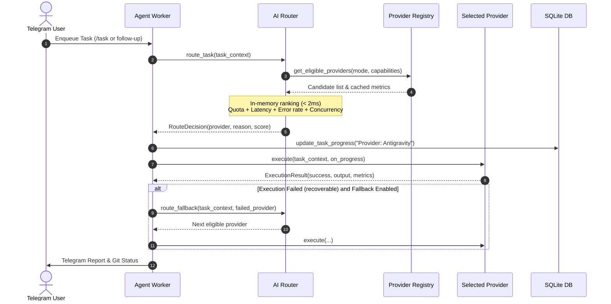

# SDD: Automatic Multi-AI Router System
Date: 2026-10-21
Status: approved

## 1. Context & Scope
- **Problem Statement:** DevTask Bot currently hardcodes Antigravity CLI as its sole execution engine in `agent_worker.py`. Adding multiple AI providers (Codex, Claude, Muse, Antigravity) requires a decoupled architecture that checks quota, error rates, recent observed latency, capabilities, and concurrency without introducing network lag into the submission path.
- **Goals:**
  - Build `BaseAIProvider` abstraction with support for auth verification, capabilities, quota status, latency tracking, and execution streaming.
  - Implement real provider adapters: `AntigravityProvider` (verified CLI engine), `CodexProvider`, `ClaudeProvider`, `MuseProvider`.
  - Create an in-memory `AIRouter` with decision latency < 2 ms (p50/p95/p99).
  - Implement ranking algorithm based on: (1) Quota & auth eligibility, (2) Task capability match, (3) Recent latency window, (4) Stability/error rate, (5) Concurrency limits, (6) Configured cost/preference policy.
  - Integrate cleanly into `agent_worker.py` while keeping existing task queues, SQLite storage, and Telegram handlers untouched.
  - Provide a safe fallback mechanism if the chosen provider encounters a recoverable error before destructive execution.
- **Non-Goals:**
  - Remote LLM completion in < 2 ms (network API and CLI execution times depend on upstream providers).
  - Faking mock quota endpoints for providers that lack official quota APIs.

## 2. Component & Flow Architecture



## 3. Interface & Data Contracts

### 3.1 Task Context & Capabilities
```python
class TaskCapability(str, Enum):
    CODE_ANALYSIS = "code_analysis"       # Read-only exploration / architecture
    CODE_MODIFICATION = "code_modification" # Modifying files, implementing features
    TEST_EXECUTION = "test_execution"     # Running test suites
    AUDIT = "audit"                       # Post-task review
```

### 3.2 Provider Status & Metrics
```python
@dataclass
class ProviderMetrics:
    total_calls: int = 0
    successful_calls: int = 0
    failed_calls: int = 0
    timeout_calls: int = 0
    rate_limit_calls: int = 0
    latency_samples: list[float] = field(default_factory=list) # sliding window (e.g. 20)
    last_error: str | None = None
    last_error_time: float | None = None
    active_concurrency: int = 0
```

### 3.3 Execution Result
```python
@dataclass
class ExecutionResult:
    provider_name: str
    exit_code: int
    output: str
    duration_seconds: float
    is_blocked: bool = False
    rate_limited: bool = False
    tokens_used: int | None = None
```

## 4. Platform & Provider Compatibility Matrix

| Provider | Integration Type | Auth Mechanism | Capabilities | Verified in Host |
|---|---|---|---|---|
| **Antigravity** | CLI (`agy`) | Local environment CLI | `ANALYSIS`, `EXECUTE`, `AUDIT` | **Yes (Default Engine)** |
| **OpenAI Codex** | API / CLI | `OPENAI_API_KEY` | `ANALYSIS`, `EXECUTE` | Conditional (when key set) |
| **Claude** | Anthropic API / CLI | `ANTHROPIC_API_KEY` | `ANALYSIS`, `EXECUTE` | Conditional (when key set) |
| **Muse AI** | API | `MUSE_API_KEY` | `ANALYSIS`, `EXECUTE` | Conditional (when key set) |
